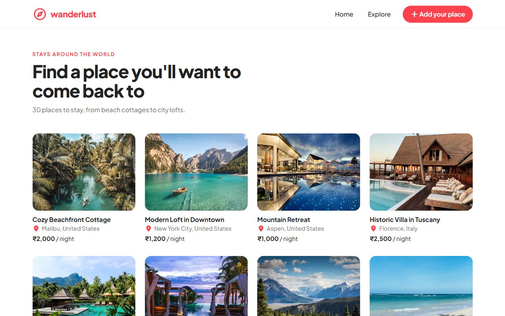

# WanderLust

Browse places to stay, list your own and leave star-rated reviews, Airbnb-style.



## Tech stack

Node.js · Express 5 · MongoDB with Mongoose · EJS with ejs-mate layouts · Bootstrap 5 · Joi validation

## Run it locally

You need [Node.js](https://nodejs.org) 20 or newer and [MongoDB Community Server](https://www.mongodb.com/try/download/community) running on the default port (27017).

```bash
npm install
node init/index.js   # adds the sample listings; press Ctrl+C after "data was initialized"
node app.js
```

Then open http://localhost:8080/listings.
